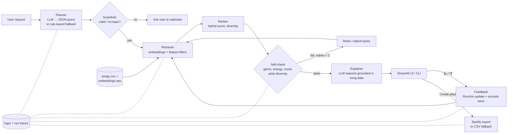

# Final Project Plan: Agentic Playlist Builder

## 1. Product: what we demo

**One sentence:** You describe a vibe in plain English, the agent finds matching songs in a music catalog, you keep or reject songs, it learns from that and brings back 5 more, and when you're happy it turns the list into a Spotify playlist.

**Demo story (the "golden path"):**

1. User types: *"recommend something chill, with jazz and indie music"*
2. **Plan:** the agent turns the request into a structured search plan: genres `[jazz, indie]`, mood `chill`, energy `0.2–0.5`, acoustic preferred, 5 songs.
3. **Retrieve (RAG):** it searches the song catalog with embeddings plus feature filters and ranks the candidates.
4. **Check:** it checks its own picks. Do they match the requested genres? Is the energy in range? Are there 5 songs? Is any artist repeated more than twice? If not, it changes the search and tries again (at most 2 retries).
5. **Present:** it shows 5 songs, each with a one-line reason drawn from the song's data (no made-up facts).
6. **Feedback loop:** the user keeps 3 songs and rejects 2. The agent moves its search toward the kept songs and away from the rejected ones, never shows a song twice, and brings back 5 more.
7. **Export:** clicking "Create playlist" writes the kept songs to a Spotify playlist, or to a fallback export if Spotify isn't set up.

**Removed:** `UserProfile`, the hard-coded profiles in `main.py`, and time-of-day logic. The user's request and feedback in this session take their place.

### Which required AI features this covers

| Requirement | How the project meets it |
|---|---|
| Something useful with AI | Retrieves data from a source and completes a step-by-step task (plan → search → check → refine → export). |
| **RAG** (core) | The LLM never invents songs. It only sees and explains songs retrieved from the catalog. |
| **Agentic workflow** (core) | Plan → act → check its own work → retry, plus refinement from human feedback. |
| **Reliability / testing** (core) | An evaluation harness with metrics, guardrails, and a simulated user for the feedback loop. |
| Fine-tuned model | Skipped on purpose. It adds the most risk for the least demo value. We'll say why in the README. |

## 2. Key design decisions (with reasons)

| Decision | Choice | Why |
|---|---|---|
| Song catalog | **Kaggle "Spotify Tracks Dataset"** (~114k tracks, 125 genres including `jazz`, `indie`, `indie-pop`, `chill`, `acoustic`), downloaded once and committed as a sampled CSV (built with `--per-genre 700`: 16,120 songs). Rows repeat once per genre, so merge them by `track_id` and combine the genres. Check the license. Not "30000 Spotify Songs": its subgenres all fall under 6 parent genres and none is jazz. **Not Apify:** it scrapes Spotify, which Spotify's terms forbid, costs credits, and doesn't return audio features. **Not the Spotify API for data:** its audio-features endpoint is closed to new apps (since Nov 2024), so energy, valence and acousticness aren't available. | 30 songs is too few for embeddings or 3 rounds of feedback. A static file means free, offline, repeatable results. Real `track_id`s make the Spotify export work. |
| Mood labels | Derive them from audio features (for example, low energy + high acousticness = "chill, mellow"). | The public data has no mood column, and this rule is easy to explain and test. |
| Embeddings | **`model2vec` with `minishlab/potion-base-8M`** (static embeddings, numpy only), run locally. Build a short text description for each song and embed it once, saving the result to `data/embeddings.npy`. Changed from sentence-transformers in Phase 1: PyTorch has no builds for Intel Macs on current Python, and dropping it keeps the Streamlit Cloud deploy small. | Free, works offline, fast on a laptop, and gives the same results every run. |
| Vector search | `numpy` cosine similarity over the saved matrix. At 2k songs this takes milliseconds and has nothing to set up. Use ChromaDB (has metadata filters) or FAISS only if the catalog grows past ~100k. | The simplest option that works; easy to unit test. |
| Keyword search | `rank_bm25` over genre, subgenre, artist and title text, combined with the embedding results by reciprocal rank fusion. | Catches exact words like "jazz" or an artist name that embeddings can blur. |
| Ranking | Final score = `0.6·fused semantic score + 0.3·feature closeness (energy/valence/acousticness) + 0.1·genre match`, with `scikit-learn` `MinMaxScaler` putting features on the same scale. Then MMR (maximal marginal relevance, ~15 lines of numpy) so the 5 picks aren't near-duplicates. Reuse ideas from the current `score_song`. | Embeddings capture the "vibe," the features keep results within the numbers, MMR keeps the list varied, and every weight is easy to explain. |
| Feedback | Rocchio relevance feedback: `q' = q + 0.7·mean(liked) − 0.3·mean(rejected)`, also applied to the feature targets. Exclude songs already shown. **This is not fine-tuning or reinforcement learning:** no model weights change. Only the search query for this session moves, and it resets when the session ends. | A classic retrieval method: simple, explainable, and measurable. |
| LLM | **Google Gemini** via the `google-genai` SDK, using a Gemini Flash model (pick the current one in AI Studio) and an API key from AI Studio in `GEMINI_API_KEY`. Used for (a) turning the request into JSON with structured output (`response_schema` = a Pydantic `SearchQuery` model) and (b) writing a one-line reason for each song from the song's data. | Ranking stays in code (testable and repeatable). The LLM handles language, which is what it's good at. Flash is fast and has a free tier. |
| Offline mode | If no API key is set, a rule-based keyword parser and template reasons are used instead. | The demo can't fail because of the network or a key, and tests run without an API. |
| Spotify | **The app proposes a playlist; it never writes to a visitor's account.** Two levels: **(1) Proposal, for everyone, no account needed:** the final song list with previews, reasons, an "Open in Spotify" link per song, and a CSV download. **(2) "Get Spotify playlist link" button:** the app uses *your* account (owner token) to create a **public playlist in your account** (`POST /me/playlists`, then `POST /playlists/{id}/items`) and shows its link. Visitors with any Spotify account (Free or Premium) can open it and choose to save it; without an account they can still listen to previews. No visitor login, so no 5-user allow-list. Guardrails: fixed playlist name (`"Vibe Mix #<n>"`, never the user's raw text, since it's public under your name), 1 playlist per session, and a `scripts/cleanup_playlists.py` to delete old ones. Keys: `SPOTIFY_CLIENT_ID`, `SPOTIFY_CLIENT_SECRET`, and `SPOTIFY_REFRESH_TOKEN` (obtained once locally with `spotipy` OAuth, scope `playlist-modify-public`) in `.env` locally and Streamlit Secrets when hosted; `.env` and `.cache` go in `.gitignore`. | Since Feb 2026, Spotify's Development Mode requires the app owner to have **Premium**, allows at most 5 users, and has removed or renamed endpoints (`POST /users/{id}/playlists` is gone; `/tracks` became `/items`). Older `spotipy` helpers may call the removed endpoints, so call the new ones directly. Forum users report 403 errors on playlist creation, so **test it before relying on it**. We never depend on Spotify for recommendations. |
| Song previews | **Spotify embed player** on each song card (`https://open.spotify.com/embed/track/{track_id}` in an iframe). It needs no API key and uses the `track_id` we already have. Logged-out visitors reportedly hear a ~30-second preview, and logged-in Premium users hear the full song. **Check in Phase 0.** Fallback: the iTunes Search API (free, no key) returns a 30-second `previewUrl` when searched by artist and title, played with `st.audio(..., end_time=10)` for a 10-second clip. | Spotify's API stopped returning `preview_url` for new apps in Nov 2024, so the embed is the simplest legal option. |
| UI | Streamlit (already in `requirements.txt`): chat box, song cards with 👍/👎, a "5 more" button, and a "Create playlist" button. A CLI script runs the same steps for the README examples. | Shows well in a 5-minute live demo, and the CLI gives repeatable output to paste into the README. |

### UI flow (Streamlit)

1. **Request:** a chat box (`st.chat_input`): *"recommend something chill, with jazz and indie music"*.
2. **Round 1:** *"This is the recommended playlist, but let us know if it looks good:"* followed by **5 songs** (`ROUND_SIZE = 5`). Each row shows the Spotify embed preview, the song's one-line reason, and a 👍/👎 widget (`st.feedback("thumbs")`).
3. **Refine:** a "Refine my playlist" button, enabled once at least one song has a vote. 👍 adds a song to the playlist and pulls the search toward it, 👎 pushes the search away from it, and songs with no vote are dropped without affecting the search. A suggested song is never suggested again.
4. **Round 2 = your playlist so far + 5 new songs.** *"Here's your playlist so far, plus 5 new songs based on your feedback:"*
   - **Your playlist so far:** every 👍 song, shown with 👍 already selected. Switching one to 👎 removes it.
   - **New suggestions:** **5 new songs** (`ROUND_SIZE = 5`), each with a preview and 👍/👎.
5. **Repeat or finish:** each refine keeps the 👍 songs and adds 5 new suggestions; every vote so far shapes the search. Or the user clicks **"Looks good, I'm done"**.
6. **Final playlist: only the 👍 songs**, with previews, the CSV download, and the optional "Get Spotify playlist link" button. Songs with 👎 or no vote are never added.

Each round is kept on screen as its own chat message, so the conversation reads top to bottom, and each round is logged with its votes for the evaluation.

## 3. Architecture



**Proposed file layout** (replacing the current profile-based code):

```
src/
  catalog.py      # load songs, derive mood tags, build/load embeddings
  planner.py      # request → SearchQuery (LLM + fallback parser)
  retriever.py    # embedding search + feature filters + hybrid ranking
  agent.py        # plan → retrieve → check → retry loop, session state
  feedback.py     # Rocchio update, seen-song exclusion
  explainer.py    # grounded per-song reasons
  guardrails.py   # input validation, output checks (only catalog IDs)
  spotify_export.py
  app.py          # Streamlit UI
  cli.py          # scripted demo runs for the README
eval/
  golden_prompts.json   # ~15 prompts with expected attributes
  run_eval.py           # prints the metrics table
tests/                  # pytest, LLM mocked
```

## 4. Reliability, guardrails, and evaluation

**Guardrails (shown in the demo):**

- **Only catalog songs:** every song ID returned must exist in the catalog; anything else is dropped and logged. Hallucinated songs are counted as a metric and should stay at 0.
- **Input checks:** empty, off-topic ("write my essay"), or unsafe requests get a polite redirect. Unknown genres (e.g. "k-pop" when the catalog has none) produce a clear "closest match" message instead of quietly returning weak results.
- **Value clamping:** energy and other feature targets are kept in [0, 1]. This fixes the current out-of-range bug (energy 1.5 gives negative points).
- **Parsing failures:** if the LLM returns invalid JSON or the API fails, fall back to the rule-based parser and log it.

**Evaluation harness (`eval/run_eval.py`), one table for the README:**

| Metric | How it's measured | Target |
|---|---|---|
| Attribute precision@5 | For each golden prompt, % of returned songs that match the requested genre/mood/energy range | ≥ 80% |
| Parser accuracy | LLM output vs. expected JSON for the golden prompts | ≥ 90% |
| Feedback lift | A **simulated user** with a hidden taste (e.g. likes only acoustic jazz) gives 👍/👎 for 3 rounds; measure % liked in each round | Goes up every round (e.g. 40% → 60% → 80%) |
| Consistency | Same prompt run 3 times: Jaccard overlap of the top 5 | ≥ 0.8 (retrieval is deterministic; only the parser varies) |
| Hallucinated songs | Songs not in the catalog | 0 |
| Self-check retries | How often the check step triggered a retry, and whether the retry fixed the problem | Reported |

**Unit tests:** catalog loading, mood derivation, ranking order, Rocchio math, seen-song exclusion, guardrails, and Spotify fallback, all with the LLM and Spotify mocked.

**Logging and errors:** Python `logging` to the console and to `logs/app.log`, with a log line for each agent step (plan, retrieve, check result, retry, feedback, export). Errors are raised for a missing catalog, a missing embeddings file (with the command to rebuild it), a bad API key, and Spotify auth failures, each with a fix-it message.

## 5. Build phases

| Phase | Work | Done when |
|---|---|---|
| 0. Align ✅ | Agree on this plan. Create the Spotify developer app and run a test script that creates one private playlist with one song | Decisions locked; Spotify test passes (or we switch to CSV only) |
| 1. Data ✅ | Sample the catalog, derive mood tags, build embeddings, remove `UserProfile` and old profiles | `python -m src.catalog build` works; 16,120 songs |
| 2. Retrieval ✅ | Retriever + hybrid ranker + rule-based parser, used from the CLI | CLI returns 5 sensible songs for the golden path |
| 3. Agent loop ✅ | LLM planner, self-check + retry, grounded explainer, guardrails | Logs show plan → retrieve → check → (retry) → present |
| 4. Feedback ✅ | Rocchio feedback, exclude seen songs, simulated user; **1 refine round by default** to fit free-tier API limits | Round 2 like rate: 70% with feedback vs 40% baseline (6 simulated users) |
| 5. UI + export | Streamlit app, Spotify export, CSV fallback | End-to-end in the browser |
| 6. Eval + tests | Golden set, `run_eval.py`, pytest suite | Metrics table produced; tests green |
| 7. Docs | README, model card, diagram, sample runs, demo script | Rubric checklist below all ✅ |
| 8. Share (optional) | Deploy the Streamlit app to Streamlit Community Cloud | Public URL works, with Spotify export off and Gemini usage capped |

The order is deliberate: phases 1–2 alone already give a working (non-LLM) demo, so if time runs short, each later phase adds features to a demo that already works.

### How others can run it

**Locally (required, what graders will do):**
- `git clone` → `python -m venv .venv` → `pip install -r requirements.txt` → `streamlit run src/app.py`.
- **Works with no keys at all.** The sampled catalog CSV and `embeddings.npy` are committed (if the dataset license allows; otherwise `scripts/download_catalog.py` fetches it with the Kaggle CLI). Without `GEMINI_API_KEY` the rule-based planner is used; without Spotify keys the CSV export is used.
- `python -m src.cli --demo` reproduces the README sample outputs, and `python eval/run_eval.py` reproduces the metrics table.

**Hosted demo (optional): Streamlit Community Cloud, not Vercel.**
- Vercel runs short-lived serverless functions. Streamlit needs a server that stays running with a websocket connection, and PyTorch (pulled in by sentence-transformers) is very likely too large for Vercel's function size limit. Making Vercel work would mean rewriting the UI in a JS framework with a separate Python backend.
- Streamlit Community Cloud is free, deploys straight from the GitHub repo, and stores keys as secrets.
- **Spotify on the hosted version works the same as locally.** Visitors never log in. Only your account calls the API, using the refresh token stored in Streamlit Secrets, so the 5-user Development Mode limit doesn't matter. Every playlist link is public and sits in your account, which is why the name is fixed and there's a per-session cap.
- **Protect your Gemini key:** cap requests per session (e.g. 10), fall back to the rule-based planner when the cap or quota is hit, and show a note that requests are sent to Google's Gemini API.

## 6. Documentation deliverables

**README.md**
- Project summary and the demo story
- Architecture diagram (the Mermaid chart above) and the component list
- Setup instructions: venv, `pip install -r requirements.txt`, `ANTHROPIC_API_KEY` (optional), Spotify keys (optional), build embeddings, run CLI / Streamlit / tests / eval
- **Sample interactions (3 cases, real output pasted):**
  1. *Golden path:* "something chill, with jazz and indie" → 5 songs → keep 3, reject 2 → 5 refined songs → playlist created
  2. *Self-check / retry:* "high-energy sad classical" (conflicting) → the check fails → the agent relaxes the query → explains the tradeoff
  3. *Guardrail:* "k-pop" (not in catalog) or an off-topic request → clear message, no made-up songs
- Design decisions (section 2 as a table)
- Testing summary: test count, pass/fail, the eval metrics table, what failed and what we changed
- Reliability and evaluation: how we test and improve the AI (section 4)
- Reflection

**model_card.md** (rewrite the current one)
- Model details: components, the LLM used and its role, the embedding model
- Intended use and out-of-scope use
- Data: catalog source and license, genre imbalance, how moods are derived
- Evaluation results (from `run_eval.py`)
- Limitations and biases: genre coverage, Western/English skew in the data, filter bubble from feedback, popularity bias, mood labels derived by rule
- **Reflection and ethics:** filter bubbles vs. discovery, effects on artist exposure, privacy (no profiles stored, session-only state), sending user text to an LLM API (on Gemini's free tier, Google may use what you send to improve its products), honesty about AI-written explanations, what we'd do differently

**ai_interactions.md:** record how the coding agent was used (counts toward the Agentic Workflow stretch section).

## 7. Five-minute presentation outline

| Time | Segment |
|---|---|
| 0:00–0:30 | Problem and one-line pitch |
| 0:30–1:15 | Architecture diagram: RAG + agent loop + feedback |
| 1:15–3:15 | **Live demo:** golden path → 👍/👎 → 5 more → Spotify playlist opens |
| 3:15–4:00 | Reliability: guardrail case + eval table + feedback-lift chart |
| 4:00–4:45 | Limitations, ethics, what I learned |
| 4:45–5:00 | Q&A buffer |

Backup: a recorded run plus the CLI transcript, in case Wi-Fi or Spotify fails during the live demo.

## 8. Rubric checklist

- [ ] End-to-end system run with 2–3 inputs → README sample interactions 1–3
- [ ] AI feature behavior (RAG + agent) → plan/check/retry log lines shown in the sample output
- [ ] Reliability/guardrail/evaluation behavior → sample 3 + eval table
- [ ] Clear outputs for each case → pasted CLI output for each

## 9. Open questions to confirm

1. ~~Spotify~~ **Decided:** real playlist export (account has Premium), CSV fallback. Test in Phase 0.
2. ~~Which Kaggle dataset~~ **Decided:** Spotify Tracks Dataset.
3. ~~LLM~~ **Decided:** Google Gemini via `google-genai`, with offline mode as the fallback.
4. ~~Catalog source~~ **Decided:** Kaggle, not Apify or the Spotify API.
