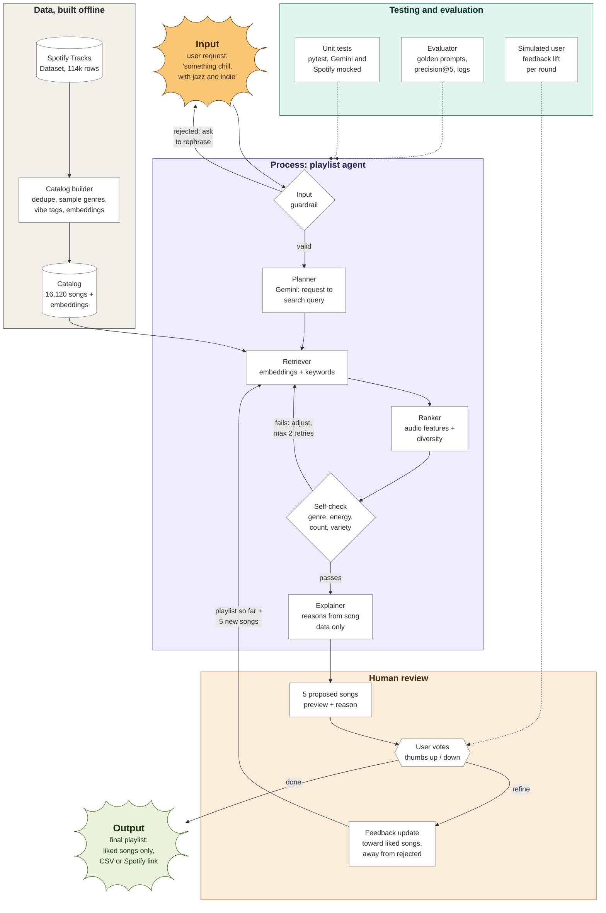

#  Music Recommender Demo - Final Project

## Project Summary

An AI playlist builder. You describe a vibe in plain English (*"recommend something chill, with jazz and indie music"*), and an agent:

1. **Plans** a search: turns the request into genres, mood and an energy range.
2. **Retrieves** matching songs from a 16,120-song catalog using embeddings and keyword search (RAG: it never invents songs).
3. **Checks its own work** (right genres? energy in range? enough variety?) and retries if the picks miss.
4. **Shows 5 songs** with a preview and a one-line reason each.
5. **Learns from your feedback.** You give each song 👍 or 👎; the next round shows your playlist so far plus 5 new songs closer to what you liked.
6. **Exports** the final playlist (👍 songs only) as a CSV or a shareable Spotify link.

AI features covered: **retrieval-augmented generation**, an **agentic workflow** (plan → act → check → retry), and a **reliability and testing system**. The full plan is in [PLAN.md](PLAN.md).

**Status:** Phases 0–2 are done: setup checks, the song catalog and embeddings, and search and ranking (try it with the CLI below). The Gemini agent, feedback loop, Streamlit app and evaluation are next; see the phases in [PLAN.md](PLAN.md).

---

## System Architecture

Source: [diagrams/system_architecture.mmd](diagrams/system_architecture.mmd). Section colors: gray = data, purple = AI agent, amber = human review, green = testing. Solid arrows are data flow; dashed arrows are testing.



### Components

| Component | What it does | Status |
|---|---|---|
| **Catalog builder** (`src/catalog.py`) | Downloads the Spotify Tracks Dataset, merges duplicates, samples 16,120 songs, adds vibe tags, builds embeddings | ✅ Built |
| **Input guardrail** | Rejects empty or off-topic requests; flags genres not in the catalog instead of returning weak matches | Partly built: empty requests rejected, unknown genres flagged with the closest match |
| **Planner** | Gemini turns the request into a structured search query; a rule-based parser (`src/parser.py`) takes over without an API key | Rule-based parser ✅; Gemini planned |
| **Retriever** | Embedding similarity plus BM25 keyword search, combined by reciprocal rank fusion (`src/retriever.py`) | ✅ Built |
| **Ranker** | 0.6 × retrieval + 0.3 × audio-feature fit + 0.1 × genre match, then MMR so picks aren't near-duplicates, one song per artist, and requested genres shared fairly (`src/ranker.py`) | ✅ Built |
| **Self-check** | Verifies genres, energy range, count and artist variety; adjusts the query and retries up to 2 times | Planned |
| **Explainer** | Gemini writes one reason per song using only that song's data; any song ID not in the catalog is dropped | Planned |
| **Feedback update** | Moves the search toward 👍 songs and away from 👎 songs; never suggests a song twice | Planned |

### Data flow

- **Input:** the user's request, typed into the app.
- **Process:** guardrail → planner → retriever (reading the catalog) → ranker → self-check (retry if it fails) → explainer.
- **Output:** 5 proposed songs per round, and finally the playlist of 👍 songs as a CSV or Spotify link.

### Where humans and tests check the AI

- **Human review:** the user votes on every song. Only 👍 songs reach the final playlist, and the votes steer the next search.
- **Self-check:** the agent checks its own picks before showing them.
- **Unit tests:** pytest covers each component with Gemini and Spotify mocked, so tests need no network or keys.
- **Evaluator:** a fixed set of test prompts with expected genres and energy ranges, scored for precision@5, consistency and made-up songs (should be 0).
- **Simulated user:** a scripted voter with a hidden taste, used to measure whether the like rate rises from round to round.

---

## Setup

Requires Python 3.10+ (tested on 3.14, including Intel Macs).

```bash
python3 -m venv .venv
source .venv/bin/activate      # Mac or Linux
.venv\Scripts\activate         # Windows
pip install -r requirements.txt
```

Run the tests (no network or API keys needed):

```bash
python -m pytest
```

## Try a search (CLI)

Search the catalog from the terminal. No API key needed: this uses the rule-based parser.

```bash
python -m src.cli "something chill, with jazz and indie music"
python -m src.cli "high energy workout metal, no rap" -k 8
python -m src.cli "chill jazz" --exclude 253 92        # skip songs already shown (catalog ids)
python -m src.cli "chill jazz" --json                   # machine-readable output
python -m src.cli "chill jazz" --verbose                # show each step's log on the console
```

Example output (Spotify links trimmed):

```text
Request: something chill, with jazz and indie music
Plan:    genres jazz, indie; moods chill; energy 0.00-0.45
Picked 5 of 200 candidates:

1. Some Kind Of Wonderful - Peter Cincotti   [jazz]   score 1.00
   id 253 | genre: jazz; feels calm, mellow, chill; energy 0.29 (in target 0.00-0.45)
2. Sunday Vibe - The BREED   [chill; jazz]   score 0.99
   id 92 | genre: jazz; energy 0.46 (near target 0.00-0.45)
3. Moon River - Louis Armstrong   [jazz]   score 0.94
   id 278 | genre: jazz; feels calm, mellow, chill; energy 0.14 (in target 0.00-0.45)
4. Pause - Prateek Kuhad   [folk; indie; indie-pop; singer-songwriter]   score 0.78
   id 713 | genre: indie; feels calm, mellow, chill; energy 0.28 (in target 0.00-0.45)
5. Light On - Maggie Rogers   [indie; indie-pop]   score 0.79
   id 969 | genre: indie; energy 0.57 (near target 0.00-0.45)
```

Song 5 is a bit more energetic than the plan asked for: the ranker treats the energy range as a preference, not a hard filter. Catching picks like this is the job of the agent's self-check in Phase 3.

How one search works:

1. **Parse** (`src/parser.py`): keyword rules turn the request into a plan: genres ("hip hop" → `hip-hop`, "no rap" → exclude `hip-hop`), moods ("chill" → energy 0–0.45, "sad" → valence 0–0.4), "acoustic", "instrumental", and a song count ("8 songs"). Genres the catalog doesn't have, like k-pop, get a note naming the closest genre.
2. **Retrieve** (`src/retriever.py`): scores all 16,120 songs by embedding similarity and by BM25 keywords, combines the two rankings with reciprocal rank fusion, drops excluded songs and genres, and keeps the top 200.
3. **Rank** (`src/ranker.py`): scores each candidate (0.6 retrieval, 0.3 audio-feature fit, 0.1 genre match), then picks the final songs with MMR, at most one song per artist and a fair share for each requested genre. Each song gets reasons built only from its catalog data.

Exit codes: `0` songs found, `1` catalog files missing or out of date, `2` empty request, `3` no songs matched. Every step is logged to `logs/app.log`.

## Song catalog and embeddings

The repo already includes the built catalog, so you only need this step to rebuild it or change the settings.

```bash
python -m src.catalog build                    # download raw data if missing, build CSV + embeddings
python -m src.catalog build --per-genre 50     # small, fast catalog (1,500 songs)
python -m src.catalog build --skip-embeddings  # CSV only
python -m src.catalog build --force-download   # fetch the raw dataset again
```

What it does:

1. **Downloads** the [Spotify Tracks Dataset](https://huggingface.co/datasets/maharshipandya/spotify-tracks-dataset) (114,000 rows, BSD license) to `data/raw/` (not committed).
2. **Merges duplicates.** The raw data repeats a song once per genre and often under several track IDs; these are merged into one row per song with all its genres (81,206 unique songs).
3. **Samples** up to 700 of the most popular songs from each of 30 genres (jazz, indie, chill, acoustic, rock, metal, …) → **16,120 songs** in `data/songs.csv`. Many genres have fewer than 700 songs left after merging duplicates (jazz has 304, latin 232), so they contribute everything they have. Genres outside the list, such as k-pop, are left out on purpose to test the "not in catalog" guardrail.
4. **Adds vibe tags** from audio features, e.g. energy < 0.4 → "calm, mellow, chill"; acousticness > 0.6 → "acoustic, organic" (rules in `vibe_tags()` in `src/catalog.py`).
5. **Embeds** one sentence per song ("Blue Moon by Billie Holiday. Genres: blues, jazz. Album: … Feels: calm, mellow, chill, acoustic.") with the static model [`minishlab/potion-base-8M`](https://huggingface.co/minishlab/potion-base-8M) → `data/embeddings.npy` (16,120 × 256, about 16 MB). Static embeddings run on numpy alone, so no PyTorch is needed. That matters because PyTorch has no builds for Intel Macs on current Python versions, and it keeps the cloud deployment small. Override the model with the `EMBEDDING_MODEL` environment variable.
6. **Records** the model name and a hash of `songs.csv` in `data/catalog_meta.json`. If the CSV changes without rebuilding the embeddings, loading fails with a clear error instead of returning wrong results.

Logs go to the console and `logs/app.log`. Common errors and fixes:

| Error | Fix |
|---|---|
| `Couldn't download the dataset` | Check your connection, or download `dataset.csv` from the link above and save it as `data/raw/spotify_tracks.csv` |
| `Couldn't load embedding model` | The first build needs internet to download the model (~30 MB); later runs use the cache |
| `data/songs.csv changed since the embeddings were built` | Run `python -m src.catalog build` |

## Spotify Developer App (optional)

Needed only for the "Get Spotify playlist link" export. Spotify's Development Mode requires the app owner to have Spotify Premium.

1. Go to <https://developer.spotify.com/dashboard>, log in, and click **Create app**.
   - **Redirect URI:** `http://127.0.0.1:8888/callback` (Spotify no longer accepts `localhost`).
   - **APIs used:** check **Web API**.
2. Open the app's **Settings** page and copy the **Client ID**, then click **View client secret** and copy that too.
3. Create your local env file and paste both values in:

```bash
cp .env.example .env
```

   `.env` is git-ignored, so your secret never gets committed. Only `.env.example` (placeholders) is tracked.

4. Check the credentials. This loads `.env` and asks Spotify for an app token:

```bash
python -m src.spotify_config
```

   It prints `Spotify credentials are valid.` on success, or logs an `ERROR` saying which variable is missing, still a placeholder, or rejected by Spotify, and exits with code 1.

---

## Limitations and Risks

- **Popular songs only:** the catalog keeps the most popular songs per genre, so it favors mainstream hits over lesser-known artists.
- **Loose genre labels:** the dataset's genres are noisy (e.g. Earth, Wind & Fire's "September" is tagged jazz), and some songs are marked instrumental even though they have vocals.
- **Rule-based vibe tags:** "calm" or "sad" come from fixed thresholds on audio features, not from listening or lyrics.
- **Limited genres:** 30 genres are included; requests for others (e.g. k-pop) can only get the closest match.

More detail, evaluation results and reflection will be in the [model card](model_card.md).

---

## Earlier version

The first version of this project was a rule-based recommender that scored a 30-song catalog against hand-written user profiles (favorite genre, mood by time of day, target energy). It was replaced by the agent above; its code is in the git history at commit `fa4251b`.
